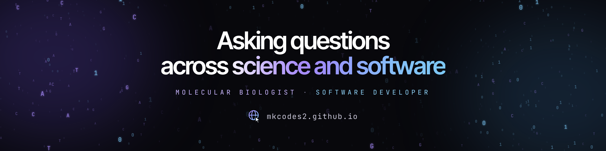

  

| 🧬 Molecular Biology &amp; Genetics BSc &nbsp; | &nbsp; 💻 Software Engineering, 42 Heilbronn &nbsp; | &nbsp; 🌐 [mkcodes2.github.io](https://mkcodes2.github.io) |
|--------------------------|----------------------------------------|------------------------------------------|

## 👋 Hi, I'm Mary Kate, or just MK!
A molecular biologist and software developer, but above all a **curious mind**. I want to research how genes shape the brain, development and behaviour, and I also bring coding to that research.

#
### 🧬 Molecular Biology

- 🎓 **BSc Molecular Biology &amp; Genetics** (DUTH), with a year of thesis research at **BRFAA** on gene regulation in breast cancer cells, and two years of training in **DNA cloning**
- 🧠 Drawn to **molecular neuroscience, developmental and behavioural biology**. More on my lab work in the [portfolio](https://mkcodes2.github.io/#/biology)

#
### 💻 Software

- 🏫 **Software Engineering at [42 Heilbronn](https://www.42heilbronn.de/en/)**, a peer-to-peer, project-based curriculum: C and Unix systems, C++, an HTTP server, Docker

- 🏓 **PongJam**, graduation project: a realtime multiplayer web platform, team of 5. I built the frontend (_TypeScript_, _Tailwind CSS_) and designed the UI/UX

- 💡 **miniRT**: a ray tracer in C, team of 2. I built the scene-file parser and the switch between display modes, and wrote the installation and user documentation

#
### 🛠️ Tech Stack

**Languages & tools:**

  
  
  
  
  
  
  
  
  
  
  

**Currently learning:**

  
  <!--  -->
  

#
### 🤝 Where to Find Me

#
🔍👇 **Check out my pinned projects below:**
